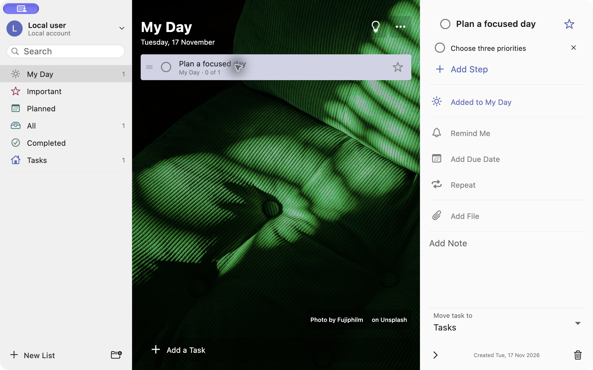

# DartToDo

A Flutter desktop/tablet/phone To Do application for one local user, with Riverpod, a generated Serverpod API and PostgreSQL on this Mac. It recreates Microsoft To Do's local task workflow and native sidebar/detail layout, without Microsoft accounts, sharing, Outlook or cloud task synchronization.

My Day selects a different free **Unsplash Featured** photo on each launch, with attribution and a cached fallback. The bordered **Folded Check** icon was selected and refined by the user in [Figma](https://www.figma.com/design/P72xp9CQ7S1SkSqLdn7ORO?node-id=15-452).

[Real iPhone/iPad screenshots and panel gallery](docs/screenshots/README.md)



## Run on this Mac

The trial uses Flutter 3.41.7 / Dart 3.11.5, Xcode 27.2 and PostgreSQL 17.11. Serverpod 3.4.12, Riverpod and Widgetbook versions are pinned in the workspace/lockfile; newer package releases can require a newer SDK. Native deployment minima are macOS 12 and iOS 15 for the installed Xcode.

PostgreSQL must be running on `localhost:5432`, with local trust access for `worajedt` and no password. Setup creates only missing `flutter_todo` / `flutter_todo_test` databases, preserves existing data and writes ignored local password configuration if absent. Docker is not used.

```sh
cd /Users/worajedt/GitHub/FlutterToDo
python3 tool/setup.py
python3 tool/run.py macos
```

For the installed simulators:

```sh
python3 tool/run.py iphone
python3 tool/run.py ipad
```

The launcher starts/reuses the loopback backend and waits for a real API response before running Flutter. Simulator IDs are the observed local devices in `tool/run.py`; choose an installed UUID there on another machine. The server stays available when a frontend closes, so the simulators and desktop app share local data. Tasks require that local service; there is no offline write queue.

## What works

- Tasks, lists and groups; notes, steps, files, importance and completion.
- My Day and suggestions, Important, Planned, All, Completed and Tasks; global title/note/step search and sorting.
- Due dates, native reminder scheduling, daily/weekday/weekly/monthly/yearly repeats and custom intervals.
- Task drag ordering, list/group order controls, moving tasks/lists, duplicate/copy/print actions, themes and local settings.
- Task/list delete with Undo; group dissolution preserves its lists and tasks.
- Adaptive desktop/iPad/iPhone layouts, keyboard shortcuts, labeled controls and Widgetbook previews for private components.

Recurrence calendar rules, recovery boundaries and remaining reference differences are explicit in the [app guide](docs/app-guide.md). This is a local recreation with measured checks; it is not a claim of exact parity with every Microsoft platform/edge case.

## Verify and inspect

```sh
python3 tool/verify.py
python3 tool/verify.py --native
cd flutter_todo_flutter
flutter run -d macos -t lib/widgetbook.dart
```

The native suite needs the configured simulators and real PostgreSQL. Missing prerequisites do not count as passes. The [trial report](docs/trial/final-report.md) records the final test/build/runtime scope, failures and limitations; [widget coverage](docs/trial/widget-coverage.md) distinguishes runtime, Figma, accessibility and golden evidence.

## Documentation and design

- [User guide](docs/app-guide.md) · [Development](docs/development.md) · [Architecture](docs/architecture.md)
- [Local security and backup](docs/security.md) · [Unsplash source/fallback](docs/unsplash.md)
- [Editable Figma screens and mapping](docs/design/figma-map.md) · [Selected icon assets](docs/design/icon-variants/folded-check-themes/README.md)
- [Trial protocol](docs/trial/protocol.md) · [GitHub tracking](docs/trial/github-tracking.md) · [Tool efficiency](docs/trial/tool-efficiency.md)

## Source releases

Releases contain a version tag and source ZIP, with no app binaries. The repository's MIT license covers original code; referenced third-party assets retain their own rights. Raw Microsoft photographs are excluded. On this Mac, setup can import optional photo themes from the installed Microsoft To Do app; the application falls back to solid colours when those assets are absent. My Day's Unsplash background does not require Microsoft assets or an API key.
