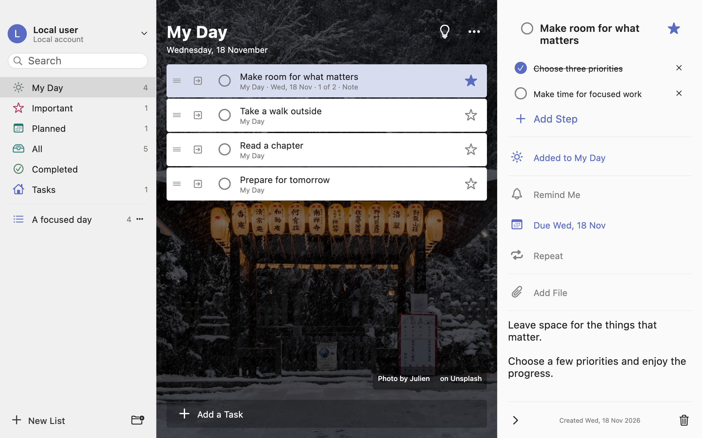

# DartToDo

A Flutter desktop/tablet/phone To Do application for one local user, with Riverpod, a generated Serverpod API and PostgreSQL on this Mac. It recreates Microsoft To Do's local task workflow and native sidebar/detail layout, without Microsoft accounts, sharing, Outlook or cloud task synchronization.

My Day selects a different free **Unsplash Featured** photo on each launch, with attribution and a cached fallback. The bordered **Folded Check** icon was selected and refined by the user in [Figma](https://www.figma.com/design/P72xp9CQ7S1SkSqLdn7ORO?node-id=15-452).

[Real iPhone/iPad screenshots and panel gallery](docs/screenshots/README.md)



## Run on this Mac

The trial uses Flutter 3.41.7 / Dart 3.11.5, Xcode 27.2 and PostgreSQL 17.11. Serverpod 3.4.12, Riverpod and Widgetbook versions are pinned in the workspace/lockfile; newer package releases can require a newer SDK. Native deployment minima are macOS 12 and iOS 15 for the installed Xcode.

PostgreSQL must be running on `localhost:5432`, with local trust access for `worajedt` and no password. Setup creates only missing `flutter_todo` / `flutter_todo_test` databases, preserves existing data and writes ignored local password configuration if absent. Docker is not used.

```sh
cd /Users/worajedt/GitHub/FlutterToDo
python3 tool/setup.py
python3 tool/run.py macos
```

For the installed simulators:

```sh
python3 tool/run.py iphone
python3 tool/run.py ipad
```

The launcher starts/reuses the loopback backend and waits for a real API response before running Flutter. Simulator IDs are the observed local devices in `tool/run.py`; choose an installed UUID there on another machine. The server stays available when a frontend closes, so the simulators and desktop app share local data. Tasks require that local service; there is no offline write queue.

## What works

- Tasks, lists and groups; notes, steps, files, importance and completion.
- My Day and suggestions, Important, Planned, All, Completed and Tasks; global title/note/step search and sorting.
- Due dates, native reminder scheduling and task-opening taps, daily/weekday/weekly/monthly/yearly repeats and custom intervals.
- Separate task handles for manual reordering and moving between lists; list/group order controls, duplicate/copy/print actions, themes and local settings.
- Task/list delete with Undo; group dissolution preserves its lists and tasks.
- Adaptive desktop/iPad/iPhone layouts, keyboard shortcuts, labeled controls and Widgetbook previews for private components.

Files on one task can total **25 MiB (26,214,400 decoded bytes)**. This implementation maps Microsoft’s published “25 MB” label to that explicit binary-byte limit; base64 transport size is counted separately. On touch screens, long-press the move handle to reveal Lists and drop onto a destination; a successful move keeps the task identity and opens its destination/details. On a wide iPad landscape layout, the first visible task opens in the inspector automatically; closing it keeps it closed until navigation or re-entry into landscape.

Recurrence calendar rules, recovery boundaries and remaining reference differences are explicit in the [app guide](docs/app-guide.md). This is a local recreation with measured checks; it is not a claim of exact parity with every Microsoft platform/edge case.

## Verify and inspect

Use the [quality tools and workflow guide](docs/quality/README.md) for each tool's configuration, when to run it, the proposed one-tool-per-round sequence, and the issue/PR process. Completed formal reports are [Analyzer Round 1](docs/quality/01-dart-analyzer.md), [Dart formatter Round 2](docs/quality/02-dart-formatter.md), [Flutter unit/widget tests Round 3](docs/quality/03-flutter-unit-widget-tests.md), [Dart backend tests Round 4](docs/quality/04-dart-backend-tests.md), [Flutter coverage Round 5](docs/quality/05-flutter-coverage.md) and [Dart backend coverage Round 6](docs/quality/06-dart-backend-coverage.md); [Rounds 7–10 and the improvement summary](docs/quality/rounds-01-10-summary.md) now add complexity assessment, custom-lint assessment, fresh catalog evidence and native integration checks. Rounds 11–13 are deferred.

The compound runner below includes real database/HTTP checks and starts or reuses the backend; `--native` adds native builds and device flows. Choose scoped checks from the guide for routine edits or a single-tool round, and confirm prerequisites before using the full runner.

```sh
python3 tool/verify.py
python3 tool/verify.py --native
cd flutter_todo_flutter
flutter run -d macos -t lib/widgetbook.dart
```

The native suite needs the configured simulators and real PostgreSQL. Missing prerequisites do not count as passes. The [issue-9 release checkpoint](docs/trial/issue-9-report.md) records 163 passing frontend tests, 51 backend tests, a separate real-HTTP attachment test and 2/2 native core tests on each target. At that checkpoint, OS notification delivery passed on all three targets; actual taps and terminated-app cold launch passed on iPhone/iPad. The catalog verified 42/42 declarations and 78/78 cases; the gallery contains 21 captures. Native print interfaces and the 120-task PDF passed; physical printing verification was skipped at the user's request. macOS notification tap/cold launch and human visual approval remain unverified. These are release-checkpoint results, not fresh verification of later commits. The [v1.0.0 trial report](docs/trial/final-report.md) remains historical; [widget coverage](docs/trial/widget-coverage.md) explains the separate runtime, Figma, accessibility and golden dimensions.

## Documentation and design

- [User guide](docs/app-guide.md) · [Development](docs/development.md) · [Architecture](docs/architecture.md)
- [Quality tools, configuration and workflow](docs/quality/README.md) · [Analyzer Round 1](docs/quality/01-dart-analyzer.md) · [Formatter Round 2](docs/quality/02-dart-formatter.md) · [Frontend tests Round 3](docs/quality/03-flutter-unit-widget-tests.md) · [Backend tests Round 4](docs/quality/04-dart-backend-tests.md) · [Flutter coverage Round 5](docs/quality/05-flutter-coverage.md) · [Backend coverage Round 6](docs/quality/06-dart-backend-coverage.md) · [Rounds 1–10 summary](docs/quality/rounds-01-10-summary.md)
- [Local security and backup](docs/security.md) · [Unsplash source/fallback](docs/unsplash.md)
- [Editable Figma screens and mapping](docs/design/figma-map.md) · [Selected icon assets](docs/design/icon-variants/folded-check-themes/README.md)
- [Trial protocol](docs/trial/protocol.md) · [GitHub tracking](docs/trial/github-tracking.md) · [Tool efficiency](docs/trial/tool-efficiency.md)

## Source releases

The current source version is **1.1.0+2**. Version tags and source ZIPs are published through [GitHub Releases](https://github.com/jedt3d/DartToDo/releases), with no app binaries. The repository's MIT license covers original code; referenced third-party assets retain their own rights. Raw Microsoft photographs are excluded. On this Mac, setup can import optional photo themes from the installed Microsoft To Do app; the application falls back to solid colours when those assets are absent. My Day's Unsplash background does not require Microsoft assets or an API key.
