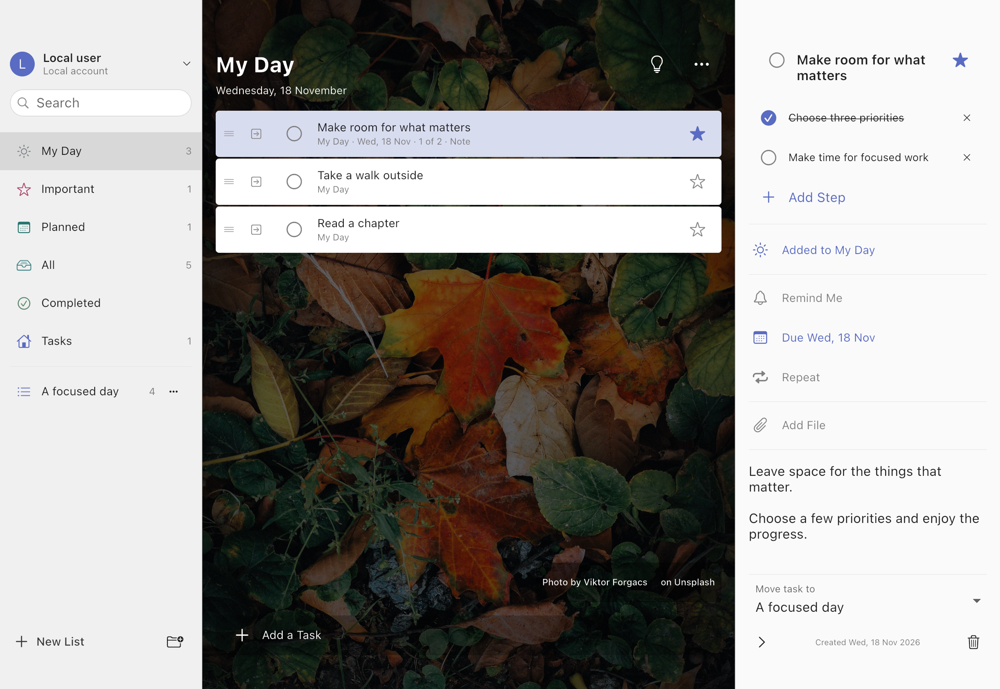
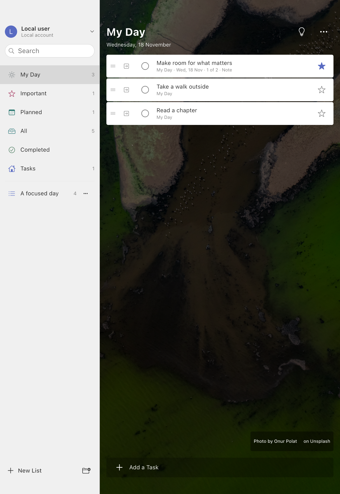

# Native app screenshots

Captured from DartToDo **1.1.0+2** on 18 November 2026 (Asia/Bangkok), using the real local Serverpod/PostgreSQL backend and temporary synthetic task data. My Day photos are real free Unsplash Featured selections; each app launch requests a randomized selection and visible attribution identifies that capture. The selected bordered Folded Check icon remains packaged in both native targets.

## iPad landscape: automatic first-task details

The **2420 × 1668** capture corresponds to **1210 × 834** logical pixels. The sidebar, task list/composer and right inspector are available together. This image is captured before selecting any task by tapping: the application opens the first visible task automatically. Closing details remains effective until navigation or re-entering landscape. Empty lists retain an appropriate empty inspector. The separate regression suite exercises those transitions and failed-save behavior.

## Phone and portrait tablet

| iPhone My Day | iPad portrait My Day |
|---|---|
|  |  |

| Panel | iPhone | iPad portrait | iPad landscape | macOS |
|---|---|---|---|---|
| My Day | [Capture](iphone-my-day.png) | [Capture](ipad-my-day.png) | [Capture](ipad-landscape-my-day.png) | [Capture](macos-my-day.png) |
| Task details | [Capture](iphone-details.png) | [Capture](ipad-details.png) | [Capture](ipad-landscape-details.png) | [Capture](macos-details.png) |
| Details while editing | [Capture](iphone-details-keyboard.png) | [Capture](ipad-details-keyboard.png) | [Capture](ipad-landscape-details-keyboard.png) | [Capture](macos-details-keyboard.png) |
| Lists and search | [Capture](iphone-lists.png) | [Capture](ipad-lists.png) | [Capture](ipad-landscape-lists.png) | [Capture](macos-lists.png) |
| Suggestions | [Capture](iphone-suggestions.png) | [Capture](ipad-suggestions.png) | [Capture](ipad-landscape-suggestions.png) | [Capture](macos-suggestions.png) |

## Capture and verification boundary

The iOS captures use Flutter's native integration screenshot handler on iPhone 16 Pro and iPad Pro 11-inch (M4), both iOS/iPadOS 18.5. OS status-bar text and keyboard pixels are outside the captured app window. Editing images show the actual resized/scrolling app area; the system keyboard region is blank. The installed Flutter 3.41 integration plugin has no macOS screenshot handler, so the macOS harness captures the actual running Flutter-rendered layer at the native pixel ratio using `RepaintBoundary.toImage`; OS window chrome is excluded.

These are original running-app PNGs, with no mockup, compositing or image edits. The host driver requires a completed flow and every expected image. Each flow opens/closes the panels, adds a suggestion and independently reads its My Day date back through the generated client. Temporary capture lists are soft-deleted afterward. [The manifest](manifest.json) records all 21 images, dimensions, digests and the relevant application source hashes. The older screenshots remain available under the v1.0.0 Git tag.

These captures support layout review and operation evidence. They do not establish exact Microsoft pixel/font parity or human visual approval. See the [issue 9 report](../trial/issue-9-report.md), [design coordination](../design/figma-map.md) and [reproduction commands](../development.md#native-screenshot-evidence).
