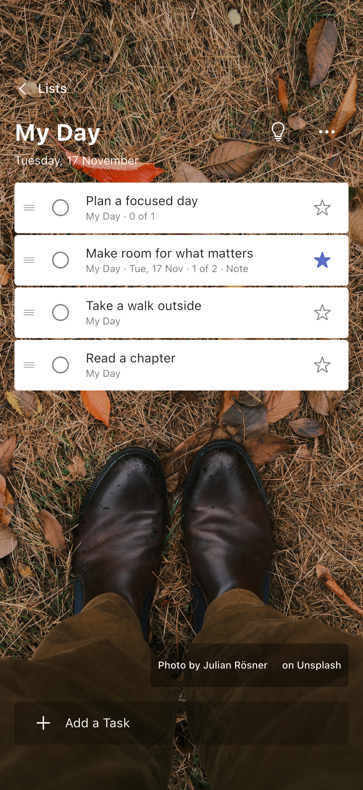

# Native app screenshots

Captured from the running DartToDo application on 17 November 2026 using synthetic task data and the real local Serverpod/PostgreSQL backend. My Day photographs are real free Unsplash Featured selections, with attribution visible in the app. The user-selected bordered Folded Check icon is packaged in both native targets.

The official Flutter integration screenshot driver captures iOS app windows on iPhone 16 Pro and iPad Pro 11-inch (M4), both iOS 18.5. System status-bar text and the keyboard are rendered outside the captured app window. Editing captures show the real resized/scrolling app area; the system keyboard region is blank in this app-window capture. The host driver retains original full-resolution PNG bytes; no UI mockup, compositing or image edits are used. The temporary screenshot list is soft-deleted after the flow. macOS captures use the running native debug app and computer-use screenshot API.

| My Day on iPhone | My Day on iPad |
|---|---|
|  |  |

| Panel | iPhone | iPad |
|---|---|---|
| Task details | [Capture](iphone-details.png) | [Capture](ipad-details.png) |
| Details while editing | [Capture](iphone-details-keyboard.png) | [Capture](ipad-details-keyboard.png) |
| Lists and search | [Capture](iphone-lists.png) | [Capture](ipad-lists.png) |
| My Day suggestions | [Capture](iphone-suggestions.png) | [Capture](ipad-suggestions.png) |

[macOS My Day](macos-my-day.png) · [macOS three-pane inspector](macos-live-detail.png)

The native capture flow opens and closes all four panels, adds a suggestion to My Day and independently reads its stored date back through the generated client. A separate native integration test creates and completes a task, saves notes/steps/importance and verifies PostgreSQL readback on all three platforms. Automated responsive tests additionally exercise portrait/landscape dimensions, system insets, 1.5× text and keyboards; native screenshots here are portrait captures. See the [trial report](../trial/final-report.md) and [capture command](../development.md#native-screenshot-evidence) for scope and reproduction.
